<div align="center">

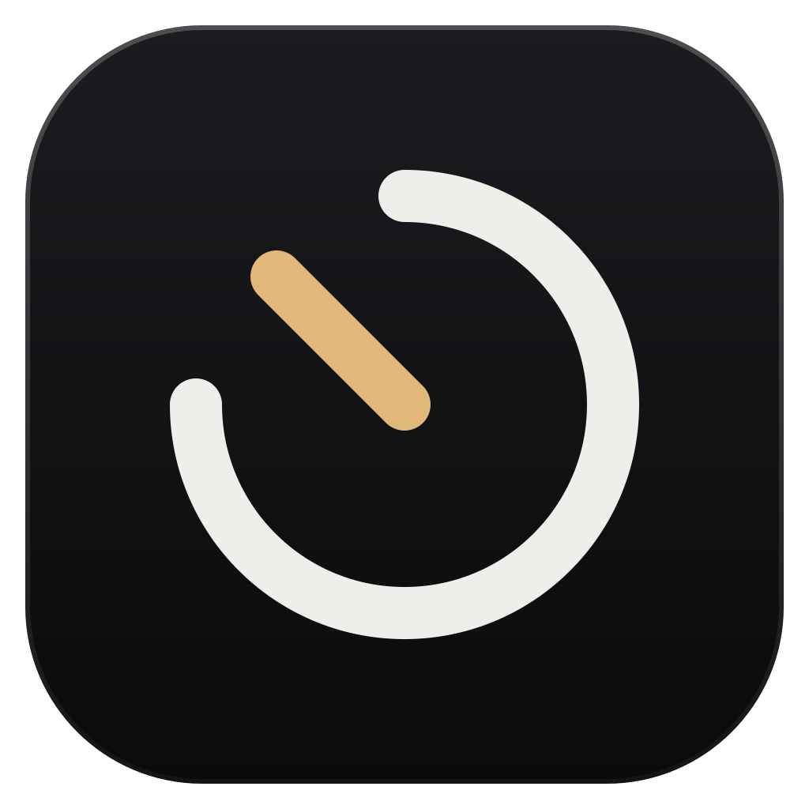

# Timetracker

Track time per project from a small button on the edge of your screen, then turn the hours into invoice-ready reports.

[](https://github.com/BetterEdgeLLC/timetracker/releases/latest)
[](LICENSE)


[**Download for Windows**](https://github.com/BetterEdgeLLC/timetracker/releases/latest)

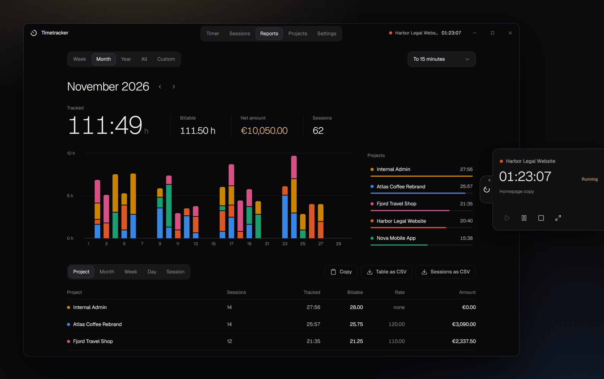

</div>

All projects, names and amounts in these images are made up.

## Install

1. Open the [latest release](https://github.com/BetterEdgeLLC/timetracker/releases/latest).
2. Download `Timetracker-Setup-1.1.1.exe` and run it. It installs for your Windows user, so you don't need admin rights.

The installer isn't code-signed, so Windows SmartScreen may warn you on first launch. Click **More info**, then **Run anyway**. If you'd rather not trust a binary, [build it yourself](#build-from-source).

Timetracker starts with Windows by default and sits in the tray. You can turn that off in Settings.

## Features

| Area | What you get |
|---|---|
| Timer | Start, pause, resume and stop per project. Breaks don't count as work. |
| Side widget | A small button in the middle of the right screen edge. Hover it and the controls slide out, over any app. Clicks next to it go through to the window below. |
| Quick project switch | Change project from the widget while the timer runs. The current session is saved and a new one starts right away. |
| Session names | Every session gets a default name from project and date. Rename it while it runs, right after stopping, or later. |
| Corrections | Add forgotten time, edit start and end, split a session into several time blocks, delete with undo. |
| Reports | View by week, month, year, all time or a custom date range. Group by project, month, week, day or session. |
| Project filter | Click projects in the legend to focus the chart, totals and table on them. |
| Billing | Hourly rate per project, net amounts in euros, optional rounding to 5, 6, 10, 15, 30 or 60 minutes, to the nearest step or always up. |
| CSV export | Export the current table or every session in the period, ready for Excel and other spreadsheets. |
| Copy to clipboard | Copy the same data without saving a file. Choose all projects or only some, then paste into Excel, Google Sheets or anywhere else. |
| Languages | English and German, switchable in Settings. A new install picks German on German Windows and English everywhere else. |
| Tray | Control the timer from the tray menu. Closing the window keeps the app running. |
| Safe by default | Standby pauses the timer. After a crash or shutdown, a running session ends at the last sign of life, so the downtime doesn't end up on an invoice. |

## A tour

### The side widget

Your timer stays one hover away, whatever app is in front.

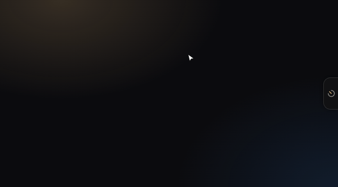

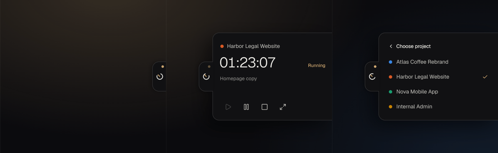

### Timer

Pick a project, press start. Today's sessions are listed below the clock.

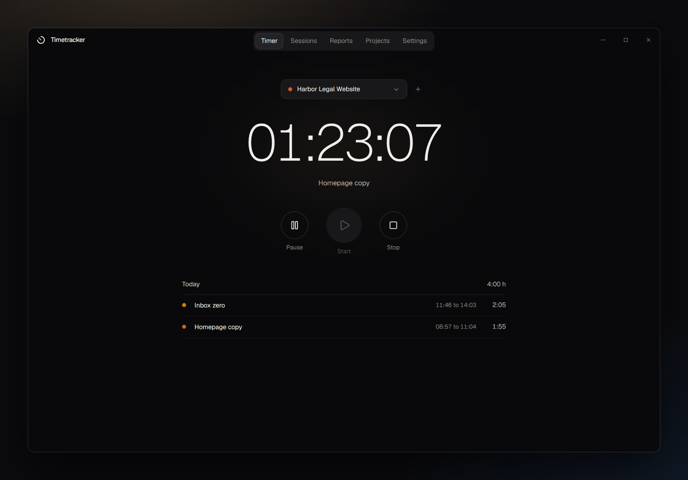

### Reports

Tracked time, billable time, net amount and session count for any period. Hover a bar to see which projects filled that day.

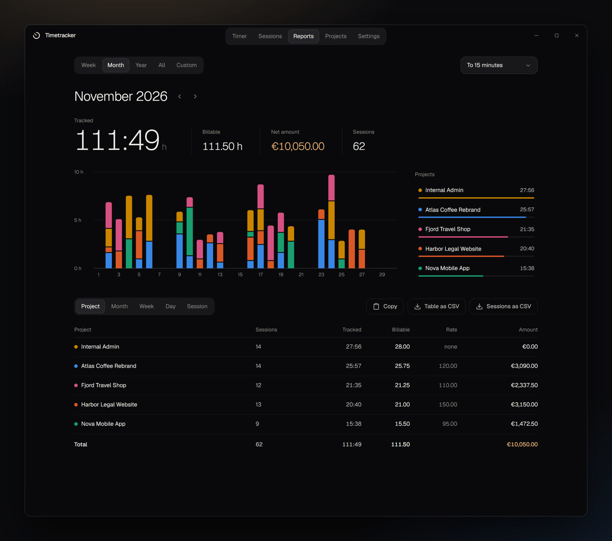

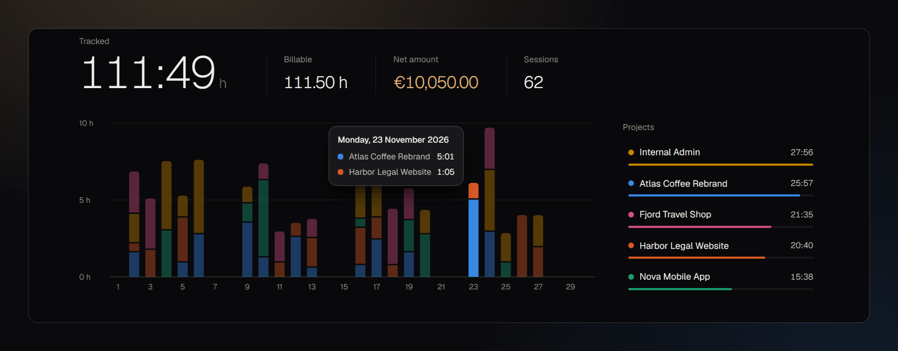

Switch to the year view and group by month when you want the whole picture.

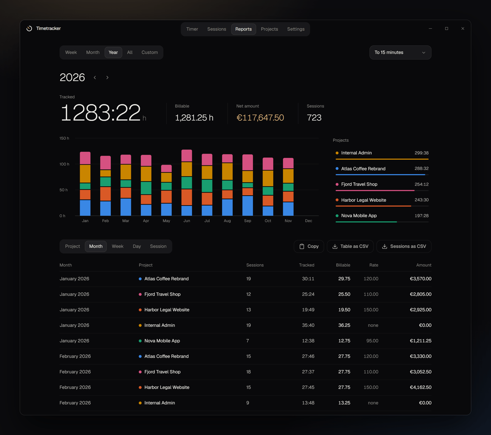

### Sessions and projects

| Sessions | Projects |
|---|---|
| 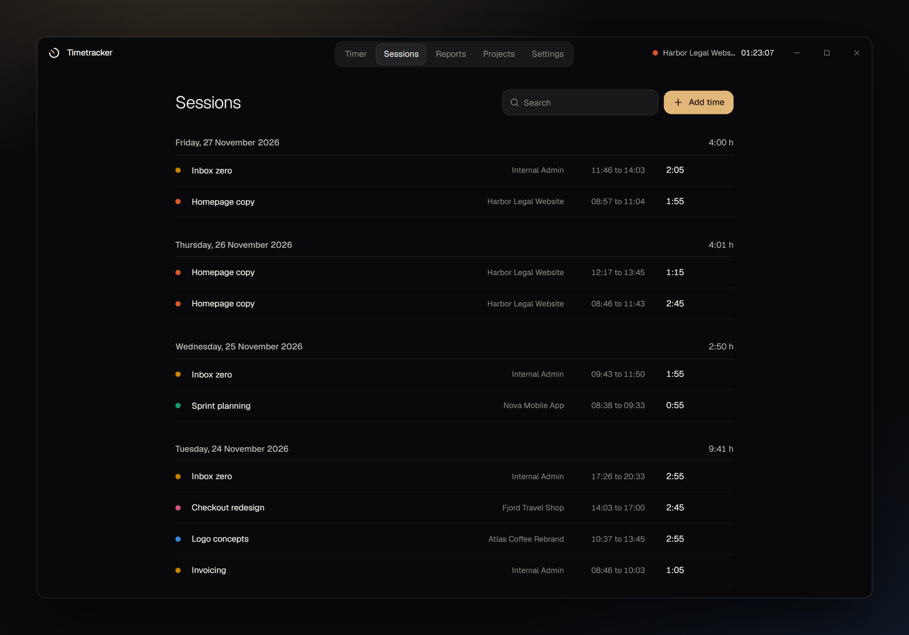 | 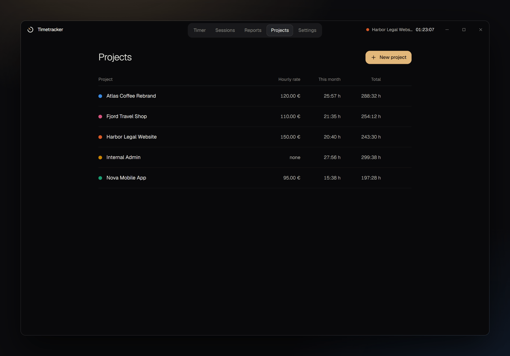 |

### Settings

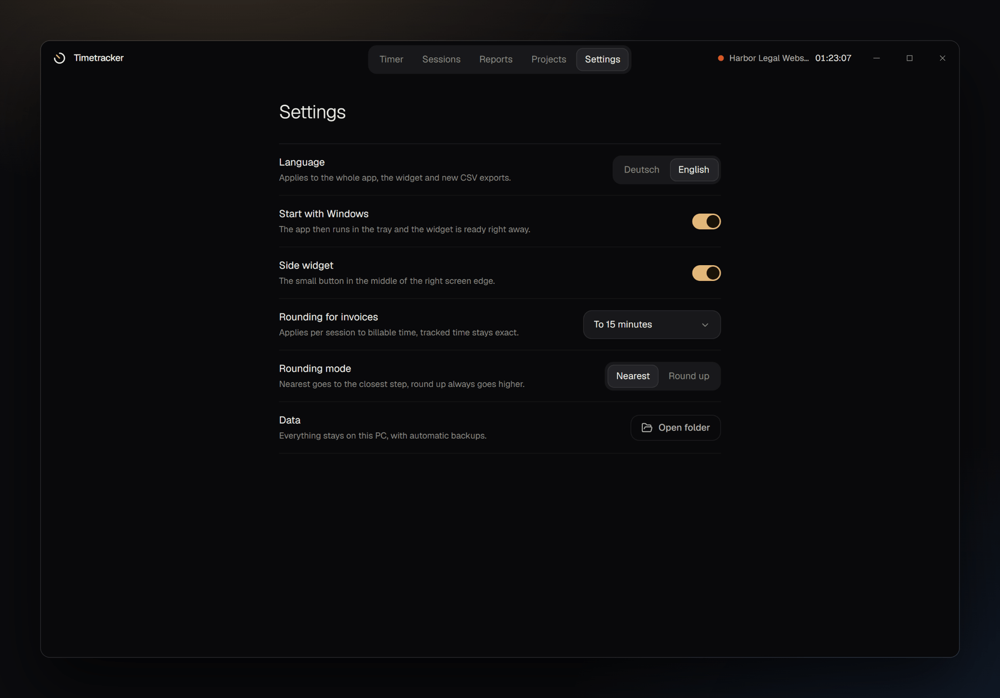

## From hours to invoice

This is the sample month from the images above, with billable time rounded to 15 minutes per session:

| Project | Sessions | Tracked (h:mm) | Billable (h) | Hourly rate (EUR) | Net amount (EUR) |
|---|--:|--:|--:|--:|--:|
| Internal Admin | 14 | 27:56 | 28.00 | | 0.00 |
| Atlas Coffee Rebrand | 14 | 25:57 | 25.75 | 120.00 | 3090.00 |
| Fjord Travel Shop | 12 | 21:35 | 21.25 | 110.00 | 2337.50 |
| Harbor Legal Website | 13 | 20:40 | 21.00 | 150.00 | 3150.00 |
| Nova Mobile App | 9 | 15:38 | 15.50 | 95.00 | 1472.50 |
| **Total** | **62** | **111:49** | **111.50** | | **10050.00** |

The same data as exported CSV, opened in a spreadsheet:

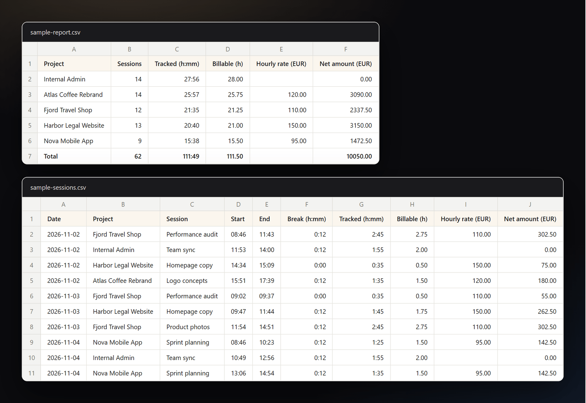

You can download both example files: [`sample-report.csv`](docs/examples/sample-report.csv) and [`sample-sessions.csv`](docs/examples/sample-sessions.csv).

Column headers follow the app language. The separator and decimal mark follow your Windows region, so Excel splits the columns correctly: semicolon and decimal comma in Germany, comma and decimal point in the US.

### Copy instead of export

**Reports > Copy** puts the numbers on the clipboard without saving a file.

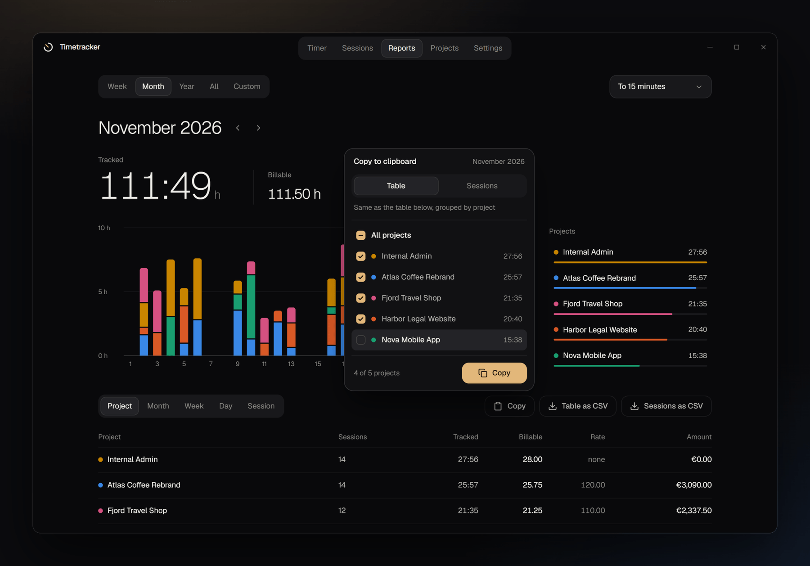

Choose **Table** for the report table with its current grouping and total row, or **Sessions** for every session with start, end and break. All projects are ticked by default. Untick the ones you don't need, or click **All projects** to clear the list and pick a few. A project filter set in the legend is the starting selection.

The copy covers the period shown on the page and has the same columns and numbers as the CSV files. Columns are separated by tabs, so each value lands in its own cell in Excel and Google Sheets. Decimal marks follow your Windows region here too.

## Your data stays on your PC

Timetracker has no account, no cloud and no analytics. Everything lives in one JSON file:

```
%APPDATA%\Timetracker\timetracker-data.json
```

The app keeps a backup next to it and refreshes that backup on every launch. Uninstalling leaves your data in place. **Settings > Data > Open folder** takes you there.

## Good to know

- A session counts completely toward the day it started, even if it runs past midnight or into the next month. That keeps every total identical across all views.
- Stopping within one second discards the run as a misclick.
- Hourly rates apply to all reports of a project, including past sessions.
- Amounts are always in euros and net of tax.
- If a period has more than eight projects, the smallest ones are grouped as "Other" in the chart.
- Windows only for now.

## Build from source

You need Windows and [Node.js](https://nodejs.org) (developed on version 24).

```powershell
git clone https://github.com/BetterEdgeLLC/timetracker.git
cd timetracker
npm ci

npm run dev        # start with hot reload
npm test           # unit tests
npm run test:e2e   # end-to-end tests against the real Electron app
npm run dist       # build the installer into release/
```

`npm run readme-assets` regenerates the images in this README after `npm run build`. It needs Chrome or Edge.

## Built with

Electron, React, TypeScript, Tailwind CSS, Motion, Radix Dialog, date-fns, Lucide icons, Sonner and the Geist typeface.

Several UI components are adapted from the [21st.dev](https://21st.dev) community. Each adapted file names its source in the first lines.

| Component | Author |
|---|---|
| [Animate Digits](https://21st.dev/@unlumen/components/animate-digits) | unlumen |
| [Toolbar Dock](https://21st.dev/@ruixen.ui/components/toolbar-dock) | ruixen.ui |
| [Segmented Tabs](https://21st.dev/@micka_design/components/tabs-base) | micka_design |
| [Great UI Animated Select](https://21st.dev/@saurabh-2607/components/great-ui-animated-select) | Saurabh Sharma |
| [Bar Chart](https://21st.dev/@kevingirelli/components/bar-chart) | kevingirelli |
| [Date Range Picker](https://21st.dev/@kuratlielia/components/date-range-picker) | kuratlielia |
| [Dialog](https://21st.dev/@originui/components/dialog) | originui |
| [Switch](https://21st.dev/@halaska-studio/components/switch) | halaska-studio |
| [Copy Button](https://21st.dev/@motiondotdev/components/motion-copy-button) | motiondotdev |

If you're one of these authors and want your credit or code changed, please open an issue.

## License

[MIT](LICENSE) for the code written for this project. The components listed above remain subject to their authors' terms.
